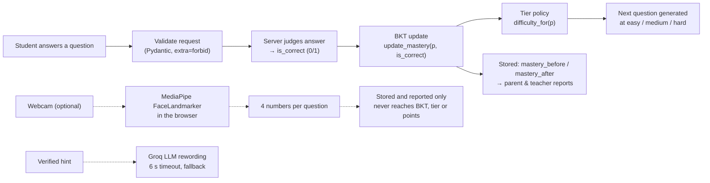

# ML components of MathVerse

This file describes every machine-learning model used in MathVerse: what it
does, what goes in and out of it, its parameters, how it was evaluated, and
where its code lives. The full write-up is the
[ML project report](report/MathVerse_ML_Project_Report.pdf). The chapter and
table numbers below refer to that report.

## Contents

1. [Overview](#1-overview)
2. [Bayesian Knowledge Tracing (the core model)](#2-bayesian-knowledge-tracing-the-core-model)
3. [Tier policy (adaptive difficulty)](#3-tier-policy-adaptive-difficulty)
4. [Baseline models](#4-baseline-models)
5. [Dataset and preprocessing](#5-dataset-and-preprocessing)
6. [Evaluation and results](#6-evaluation-and-results)
7. [MediaPipe FaceLandmarker (attention estimate)](#7-mediapipe-facelandmarker-attention-estimate)
8. [Groq language model (hint wording)](#8-groq-language-model-hint-wording)
9. [What is deliberately not machine learning](#9-what-is-deliberately-not-machine-learning)
10. [Limitations and future work](#10-limitations-and-future-work)
11. [Reproducing the results](#11-reproducing-the-results)
12. [File map](#12-file-map)

---

## 1. Overview

| # | Model | Type | Role in MathVerse | Trained by the team? | Code |
|---|---|---|---|---|---|
| 1 | **Bayesian Knowledge Tracing (BKT)** | Probabilistic, two-state hidden Markov model | Estimates mastery per student per topic, predicts the next answer, drives difficulty | No: fixed textbook parameters | `backend/services/mastery.py` |
| 2 | Tier policy | Threshold rule on the BKT output | Easy below 0.40, hard above 0.75, otherwise medium | No | `backend/services/mastery.py` (`difficulty_for`) |
| 3 | Running accuracy | Baseline | Predicts the share of answers correct so far | No | `backend/tools/evaluate_mastery.py` |
| 4 | Last answer only | Baseline | Predicts that the next answer will match the previous one | No | `backend/tools/evaluate_mastery.py` |
| 5 | Constant (overall rate) | Baseline | Predicts the overall correct rate for everyone | No | `backend/tools/evaluate_mastery.py` |
| 6 | **MediaPipe FaceLandmarker** | Pre-trained deep network, run in the browser (WebAssembly) | Face landmarks give head angles and eye state for an optional attention estimate | No: inference only | `frontend/src/lib/attention/` |
| 7 | **Groq LLM** (`openai/gpt-oss-120b`) | Large language model, called through an API | Rewords an already-verified hint in Spider-Gwen's voice | No: prompted only | `backend/services/hints.py` |



The two dashed paths are optional. The game works the same without them.

---

## 2. Bayesian Knowledge Tracing (the core model)

### 2.1 What it does

For every student and every one of the six topics, BKT keeps one number, **p**:
the probability that the student has learned the topic. Report Section 4.3
describes it in full.

- **Input:** only whether the latest answer was right or wrong (`is_correct`).
- **Output:** the new mastery estimate `p`, and from it the predicted chance
  that the next answer is correct.
- **Used for:** choosing the next question's difficulty (Section 3), predicting
  the next answer, and the per-topic band shown on parent and teacher reports.

The six topics are linear equations, area and perimeter, sequences,
percentages, exponents and roots, and ratios. Each one has its own independent
estimate.

### 2.2 Why BKT, and not an LSTM or Deep Knowledge Tracing

| Concern | BKT | LSTM / Deep Knowledge Tracing |
|---|---|---|
| Data needed | Works from the first answer with textbook parameters | Needs tens of thousands of real interaction sequences |
| Explainability | Every parameter has a plain meaning (prior, guess, slip, learn) | Cannot say why a value changed |
| Trustworthy reports | Can be made monotonic (Section 2.5) | No such guarantee |
| Evidence | Careful BKT variants close much of the gap to DKT (Khajah et al., 2016) | Outperforms BKT mainly on large datasets (Piech et al., 2015) |

The first prototype used an LSTM trained only on synthetic students, so it
learned the simulator, not real students. The final system replaced it with
BKT (report Sections 1.2 and 4.2).

### 2.3 Parameters

| Symbol | Name | Value | Meaning |
|---|---|---|---|
| p₀ | Prior | **0.30** | Chance the topic is already known before the first question |
| g | Guess | **0.25** | Chance of a right answer without knowing it (four options) |
| s | Slip | **0.10** | Chance of a wrong answer despite knowing it |
| ℓ | Learn | **0.15** | Chance of learning the topic from one question (applied after correct answers only) |
| — | Clamp range | **[0.01, 0.99]** | The model never claims total certainty |
| — | Rounding | **4 decimals** | Stored precision |

These are standard textbook values, not fitted to data. No real dataset existed
to fit them (report Sections 4.4 and 5.3).

### 2.4 Equations

Predicted chance that the next answer is correct (report Eq. 4.1):

```
P(correct) = p(1 − s) + (1 − p)·g
```

After a **correct** answer, Bayes' rule is applied, then the learning step (Eq. 4.2):

```
p′    = p(1 − s) / [ p(1 − s) + (1 − p)·g ]
p_new = p′ + (1 − p′)·ℓ
```

After a **wrong** answer, only Bayes' rule is applied (Eq. 4.3):

```
p_new = p·s / [ p·s + (1 − p)(1 − g) ]
```

The result is clamped to [0.01, 0.99] and rounded to 4 decimals.

**Worked example, starting from the prior 0.30:**

| Answer | Step | Result |
|---|---|---|
| Correct | Posterior = 0.27 / (0.27 + 0.175) | 0.607 |
| | Learning step = 0.607 + 0.393 × 0.15 | **0.666** |
| Wrong | 0.03 / (0.03 + 0.525) | **0.054** |

### 2.5 Our change to textbook BKT

Textbook BKT applies the learning step after **every** answer. At low mastery
that lets a **wrong** answer **raise** the estimate: 0.05 becomes about 0.16.
That is statistically defensible, but it is confusing on a child's progress
report.

MathVerse applies the learning step **only after correct answers**. As a result:

- a correct answer **always raises** mastery;
- a wrong answer **always lowers** mastery.

`backend/tests/test_mastery.py` checks both directions for every starting value
from 0.01 to 0.99. `update_mastery(p_mastery, is_correct)` has no other
parameter, so camera or attention data has no way to reach it.

### 2.6 Implementation (`backend/services/mastery.py`)

```python
PRIOR, P_GUESS, P_SLIP, P_LEARN = 0.30, 0.25, 0.10, 0.15
P_MIN, P_MAX = 0.01, 0.99            # never claim total certainty
EASY_BELOW, HARD_ABOVE = 0.40, 0.75

def update_mastery(p_mastery: float, is_correct: bool) -> float:
    p = min(P_MAX, max(P_MIN, p_mastery))
    if is_correct:
        posterior = p * (1 - P_SLIP) / (p * (1 - P_SLIP) + (1 - p) * P_GUESS)
        new_p = posterior + (1 - posterior) * P_LEARN
    else:
        new_p = p * P_SLIP / (p * P_SLIP + (1 - p) * (1 - P_GUESS))
    return round(min(P_MAX, max(P_MIN, new_p)), 4)
```

### 2.7 How it runs in the app (online learning)

The model learns online, one answer at a time, inside the request that receives
the answer:

1. The browser sends only the index of the chosen option.
2. The server compares it with the stored answer and creates the label
   `is_correct`. A client cannot fake a correct label.
3. The server reads `p` for that student and topic, calls `update_mastery`,
   and stores `mastery_before` and `mastery_after` on the attempt.
4. `difficulty_for(p)` picks the tier of the next question.

---

## 3. Tier policy (adaptive difficulty)

```python
def difficulty_for(p_mastery: float) -> str:
    if p_mastery < 0.40:  return "easy"
    if p_mastery > 0.75:  return "hard"
    return "medium"
```

| Mastery p | Next question |
|---|---|
| below 0.40 | easy |
| 0.40 to 0.75 | medium |
| above 0.75 | hard |

A student who struggles gets easier questions at once, and a student who
succeeds moves up quickly. From the prior, two correct answers are enough to
reach the hard tier. Because the estimate moves this fast, reports show a band
and a percentage capped to 5–95% rather than the raw value.

---

## 4. Baseline models

A useful student model has to beat simple predictors. Every baseline predicts
each answer **before** seeing it, exactly as BKT does.

| Baseline | Prediction for the next answer | Weakness |
|---|---|---|
| **Running accuracy so far** | (correct so far + 1) / (answers so far + 2): smoothed, starts at 0.5 | Treats the 1st and 20th answer equally, so it reacts slowly to learning |
| **Last answer only** | 0.5 for the first answer, then 0.8 if the last answer was right, 0.3 if wrong | Reacts too fast and is fooled by every guess or slip |
| **Constant (overall rate)** | The overall correct rate, the same for everyone | Uses no information about the student; AUC is 0.5 by definition |

BKT sits between the first two because it models guessing and slipping
explicitly.

---

## 5. Dataset and preprocessing

### 5.1 Data sources (report Chapter 3)

| Source | What it is | Used for |
|---|---|---|
| **Simulated students** (main evaluation data) | Generated by `backend/tools/evaluate_mastery.py`. Two scenarios of 5,000 students × 20 answers, giving 100,000 labelled answers each | Training-free evaluation of BKT and the baselines |
| **In-app interaction log** (real data) | One row per answered question in the `attempts` table | Real-data evaluation once there is enough of it. As of 20 Nov 2026 there were only 9 real answers from 1 student, so no real-data result is claimed |
| **Question data** | Not a dataset: 18 generators (6 topics × 3 tiers) build questions from random numbers and compute the answer, plus 36 story templates and a backup bank of 36 questions | Serving questions |

No public dataset was used. Simulating students whose true hidden state is
known is the standard practice in knowledge tracing when real data is missing.

### 5.2 How a simulated student is generated

Each student starts knowing the topic with probability *prior*. They answer
correctly with probability 1 − slip if they know it, and with probability
*guess* if they do not. After each answer, a student who does not yet know the
topic learns it with probability *learn*.

| Parameter | Scenario 1: students match the model | Scenario 2: students differ (robustness) |
|---|---|---|
| Students × answers | 5,000 × 20 | 5,000 × 20 |
| Prior | 0.30 | 0.20 |
| Guess | 0.25 | 0.30 |
| Slip | 0.10 | 0.15 |
| Learn | 0.15 | 0.10 |
| Predictions | 100,000 | 100,000 |
| Random seed | 7 | 7 |

Scenario 2 deliberately breaks the model's assumptions, so BKT is not graded
only on data shaped like itself.

### 5.3 Features

| Feature | Type | Description |
|---|---|---|
| `student_id` | integer | Simulated student, 1–5,000 |
| `step` | integer | Position of the answer in the sequence, 1–20 |
| `is_correct` | binary (**target**) | 1 if correct, 0 if wrong; the value the models predict |
| `true_learned` | binary (hidden) | Whether the student truly knows the topic at that step. Never shown to the model; used only to evaluate the estimate |
| `scenario` | category | 1 = students match the model, 2 = students differ |

The real `attempts` table stores more fields per answer, but **only
`is_correct` reaches the mastery model**:

| Field | Used by BKT? |
|---|---|
| `topic`, `difficulty` | Selects which estimate is updated |
| `is_correct` | **Yes: the only input** |
| `response_time_ms`, `hint_used` | No: scoring and reports only |
| `mastery_before`, `mastery_after` | The model's output, stored for reports |
| `face_present_pct`, `on_screen_pct`, `blink_rate_per_min`, `attention_score`, `attention_label` | No: stored and reported only; NULL when not measured |

### 5.4 Preprocessing

1. **Validation.** Every request is checked against a strict Pydantic schema
   (`extra="forbid"`), so no extra field, image or binary data can enter.
2. **Label creation on the server.** `is_correct` is computed by the server,
   never sent by the client.
3. **Sequencing.** Answers are grouped by student and topic and ordered by time.
4. **Predict before update (no leakage).** Each model predicts an answer before
   seeing it, then is updated, in evaluation and in live use.
5. **Clamping and rounding** to [0.01, 0.99] and 4 decimals.
6. **Missing values.** Camera fields are NULL when not measured, never zero.
7. **Camera features** are aggregated per question into four numbers (Section 7).

### 5.5 What the data looks like (EDA, report Section 3.4)

| Statistic | Scenario 1 | Scenario 2 |
|---|---|---|
| Correct answers per student (mean ± SD) | 15.21 ± 3.64 | 13.11 ± 4.11 |
| Share of answers correct | 76.0% | 65.5% |
| Students in the learned state, answer 1 → 20 | 30.0% → 97.0% | 20.2% → 88.9% |
| Correct rate, answer 1 → 20 | 44.9% → 88.5% | 40.3% → 79.4% |

What this means for modelling:

- **The classes are imbalanced** (about 76% correct). A model that always
  predicts "correct" already reaches about 75% accuracy, so **AUC and the
  Brier score are the main metrics**, not accuracy.
- **The data is sequential and not i.i.d.** The chance of a correct answer
  changes within a sequence, so a model must update after each answer.
- **Students differ widely**, which is why the estimate is kept per student and
  per topic.

---

## 6. Evaluation and results

### 6.1 Metrics

| Metric | What it measures | Better |
|---|---|---|
| **AUC** (ROC) | Chance a random correct answer is given a higher predicted probability than a random wrong one. Not affected by class imbalance, so it is the **main metric** | Higher (0.5 = chance) |
| Accuracy | Share predicted correctly at a 0.5 threshold. Reported for completeness | Higher |
| **Brier score** | Mean of (predicted probability − outcome)², i.e. calibration | Lower |
| Log loss | Mean negative log-likelihood | Lower |
| Mastery vs true state AUC | How well the BKT estimate separates students who truly know the topic (only possible with simulated data) | Higher |
| Tier decision match | How often the easy/hard choice agrees with the true state | Higher |
| Answers to recognise learning | Answers needed, after a student truly learns, for the estimate to cross the hard threshold | Lower |

### 6.2 Next-answer prediction (report Table 6.1)

**Scenario 1: students match the model** (100,000 predictions)

| Model | AUC | Accuracy | Brier | Log loss |
|---|---|---|---|---|
| **BKT (this project)** | **0.770** | **78.3%** | **0.151** | **0.469** |
| Running accuracy so far | 0.744 | 74.1% | 0.182 | 0.547 |
| Last answer only | 0.696 | 74.7% | 0.173 | 0.524 |
| Constant (overall rate) | 0.500 | 75.3% | 0.186 | 0.559 |

**Scenario 2: students differ from the model** (100,000 predictions)

| Model | AUC | Accuracy | Brier | Log loss |
|---|---|---|---|---|
| **BKT (this project)** | **0.729** | **70.9%** | **0.196** | **0.578** |
| Running accuracy so far | 0.704 | 66.9% | 0.214 | 0.619 |
| Last answer only | 0.646 | 66.3% | 0.219 | 0.630 |
| Constant (overall rate) | 0.500 | 65.8% | 0.225 | 0.642 |

### 6.3 How well the estimate tracks the truth (report Table 6.2)

| Metric | Target | Achieved |
|---|---|---|
| Mastery estimate vs true state, AUC (Sc. 1 / Sc. 2) | — | **0.941 / 0.916** |
| Easy/hard choice matches true state (Sc. 1 / Sc. 2) | > 85% | **89.6% / 87.3%** |
| Answers to recognise a learned topic | median ≤ 5 | **median 3** (90th percentile 5) |
| Monotonic update over 0.01–0.99 | all tests pass | all pass |
| Backend / frontend tests passing | all | 469 / 469 and 231 / 231 |

### 6.4 Discussion

- BKT beats every baseline on every metric, in **both** scenarios.
- Against the strongest baseline (running accuracy), AUC rises from 0.744 to
  **0.770** and the Brier score falls from 0.182 to **0.151**.
- The constant predictor reaches 75.3% accuracy with no information at all, but
  its AUC is 0.500. This is why accuracy alone is misleading here.
- In Scenario 2 every model drops, but BKT keeps its lead (0.729 vs 0.704), so
  its advantage does not come only from the data matching its assumptions.
- The gain is clearest in the Brier score. BKT's probabilities are better
  calibrated, which matters because the probability itself chooses the tier.

### 6.5 Evaluation tools

| Tool (run from `backend/`) | What it does |
|---|---|
| `python tools/evaluate_mastery.py` | Simulates both scenarios, runs BKT and the three baselines with predict-then-update, and prints every number in 6.2 and 6.3. Optional argument: number of students (default 5,000) |
| `python tools/evaluate_real_data.py` | Same comparison on **real** answers in the database, using `mastery_before` for the prediction. Counts real accounts only (no demo or test accounts). Gives a 95% bootstrap interval for (BKT AUC − running-accuracy AUC), resampling whole students. Below **200 answers from 10 students** it reports "not enough data" instead of figures |
| `python tools/evaluate_metrics.py` | Summary report on the local database: accuracy per topic, BKT next-item accuracy, RMSE, precision, recall, F1 and confusion matrix, and camera-estimate averages |

Saved output of the first tool: [`results/bkt_simulation_results.txt`](results/bkt_simulation_results.txt).

---

## 7. MediaPipe FaceLandmarker (attention estimate)

### 7.1 What it is

A **pre-trained** deep network from Google's MediaPipe Tasks Vision that finds
face landmarks in each webcam frame. MathVerse runs **inference only**, entirely
**inside the browser** via WebAssembly. No frame ever leaves the device. The
model is loaded on demand, so a student who never turns the camera on never
downloads it.

| Setting | Value |
|---|---|
| Model file | `frontend/public/models/face_landmarker.task` |
| Running mode | `VIDEO` |
| Faces tracked | 1 |
| Outputs used | Face landmarks, face blendshapes, facial transformation matrix |
| Sample rate | about 10 readings a second (every 100 ms) |

### 7.2 Features extracted per reading

| Feature | How it is computed |
|---|---|
| Face present | A face was found in the frame |
| Head yaw / pitch | From the facial transformation matrix |
| Eyes closed | Both `eyeBlinkLeft` and `eyeBlinkRight` blendshape scores > 0.5 |

### 7.3 From readings to four numbers per question

1. **Calibration:** the first **5 seconds** set the student's own resting head position.
2. A reading counts as **facing the screen** within **±30° yaw** and **±20° pitch** of that position.
3. Per question, readings are aggregated into **four numbers**:
   face-present %, facing-the-screen %, blinks per minute, and seconds measured.
   The blink rate needs at least 5 seconds with a face present and is capped at 200 per minute.
4. The server turns them into a score and label (`backend/services/attention.py`):

| Condition | Label |
|---|---|
| face present < 50% | Away |
| facing the screen ≥ 80% | Focused |
| facing the screen ≥ 50% | Partly focused |
| otherwise | Distracted |

Score = facing-the-screen % / 100.

### 7.4 Strict limits on how it is used

- **Optional.** The camera is off unless the student agrees, and the game is
  identical either way.
- **Never affects learning.** Mastery, difficulty, points, unlocks and hints
  never read attention data. Tests check this.
- **No images.** At most four numbers per question are sent. Nothing is
  uploaded or stored as an image or video.
- **Not a medical assessment.** It is an estimate of head direction, not eye
  gaze, and not a measure of ability or a diagnosis of anything.
- **Missing data stays NULL**, never zero.

### 7.5 Real-hardware check (report Section 6.2)

On a scripted real-webcam run (one laptop, Chrome on Windows 11, one adult
tester):

- The tracker produced 10 readings a second, and switching the camera off
  stopped the stream at once.
- Clear turns left or right were counted as facing the screen 0–11% of the time.
- Looking down at the keyboard or a phone was still counted as facing about 80%
  of the time, because the estimate follows head direction rather than eye gaze.

This is acceptable only because the estimate is reported and never drives a
learning decision. Details: [`docs/WEBCAM_TEST_PLAN.md`](docs/WEBCAM_TEST_PLAN.md).

---

## 8. Groq language model (hint wording)

### 8.1 What it does

Every question already has a correct, plain hint, written by the question
generator from the question's own numbers. If a Groq API key is configured, a
large language model is asked to do **one thing only**: re-say that verified
hint in Spider-Gwen's voice. It is told not to add maths of its own and not to
reveal the answer.

| Setting | Value |
|---|---|
| Provider / model | Groq API, `openai/gpt-oss-120b` (changeable with `GROQ_MODEL`) |
| Temperature | 0.6 |
| Max tokens | 800 (part is used for hidden reasoning) |
| Timeout | 6 seconds, no retries |
| Maximum hint length | 400 characters, at most 2 sentences |
| Input | Villain, topic, key idea, question text, the verified hint |

### 8.2 Safeguards

- **Fallback:** if the model is slow (> 6 s), fails, or returns something
  unusable or too long, the plain hint is shown instead.
- **Optional:** with no `GROQ_API_KEY` the built-in hints are used and the game
  works the same.
- **No invented content:** the LLM never writes questions, answers, scores or
  report text. Language models make arithmetic mistakes, so they are not trusted
  with the maths.

---

## 9. What is deliberately not machine learning

| Part | How it works | Why not ML |
|---|---|---|
| Questions and answers | 18 code generators (6 topics × 3 tiers), random numbers, computed answers; 36 story templates; 36-question backup bank. Tests re-solve 300 random questions per generator and tier from the question text | An LLM could write wrong maths |
| Hints | Computed from the question's own numbers | A computed hint cannot be wrong |
| Points, levels, unlocks | Fixed game rules on the server | Must be predictable and fair |
| Report observations | Rules over stored answers | Every figure must trace to a real answer |

---

## 10. Limitations and future work

**Limitations (report Section 7.3)**

- BKT parameters are textbook defaults, not fitted to real data, and topics are
  treated independently.
- The evaluation uses simulated students. Only 9 real answers existed, so no
  real-data result is claimed.
- The model ignores response time and hint use, which may carry information.
- Two correct answers move the estimate from the prior to about 0.90, so the
  model can be over-confident early in a topic.
- The camera estimate was checked on one device with one tester. It follows
  head direction, not eye gaze.

**Future work (report Section 7.4)**

1. **Fit BKT to real data** per topic with expectation–maximisation, then
   compare against Performance Factors Analysis and Deep Knowledge Tracing
   using `tools/evaluate_real_data.py`.
2. **Individualised BKT:** per-student priors or learning rates, and contextual
   guess and slip.
3. **More features:** response time, hint use, and links between related topics.
4. **Broader vision testing** across browsers, cameras, lighting and devices,
   and eye-gaze features instead of head direction.
5. **Responsible deployment:** verified guardian consent, and original
   characters in place of the Marvel ones used in this non-commercial course
   project.

---

## 11. Reproducing the results

```bash
cd backend
python tools/evaluate_mastery.py        # report Table 6.1 and 6.2, about 1 second
python tools/evaluate_mastery.py 1000   # quicker, fewer students
pytest tests/test_mastery.py tests/test_evaluate_mastery.py   # model tests
```

The simulation uses only the Python standard library and a fixed seed (7), so
the numbers are identical on every run.

---

## 12. File map

| File | What is in it |
|---|---|
| `backend/services/mastery.py` | BKT parameters, `update_mastery`, `difficulty_for` |
| `backend/services/mastery_display.py` | Mastery band and capped percentage for reports |
| `backend/tools/evaluate_mastery.py` | Simulated students, baselines, metrics |
| `backend/tools/evaluate_real_data.py` | Real-data evaluation with bootstrap interval |
| `backend/tools/evaluate_metrics.py` | Database summary metrics |
| `backend/tests/test_mastery.py` | Monotonicity, topic independence, tier thresholds, no attention input |
| `backend/tests/test_evaluate_mastery.py`, `test_evaluate_real_data.py` | Tests for the evaluation tools |
| `backend/services/attention.py` | Score and label from the four camera numbers |
| `backend/services/hints.py` | Verified hint and optional LLM wording |
| `frontend/src/lib/attention/detector.ts` | The only file that touches MediaPipe |
| `frontend/src/lib/attention/summary.ts` | Calibration, angle limits, per-question summary |
| `frontend/src/lib/attention/tracker.ts` | 10-per-second sampling loop |
| `results/bkt_simulation_results.txt` | Saved output of the simulation |
| `report/MathVerse_ML_Project_Report.pdf` | The submitted ML project report |
