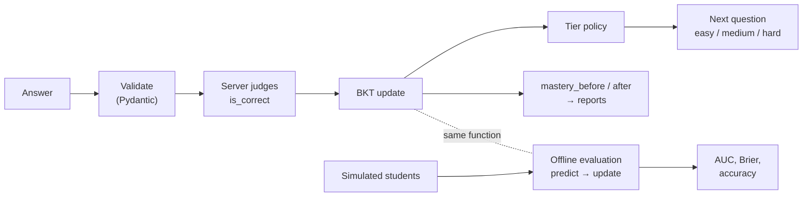

# MathVerse: Adaptive, Gamified Mathematics Practice using Bayesian Knowledge Tracing

**Machine Learning Project**, BE Third Year, Computer Science and Engineering,
Thapar Institute of Engineering and Technology, Patiala (November 2026).
Supervisor: Dr Mahak Gambhir.

📄 **Report:** [ML_Project_Report/MathVerse_ML_Project_Report.pdf](ML_Project_Report/MathVerse_ML_Project_Report.pdf)
🧠 **Every ML model in detail:** [ML_COMPONENTS.md](ML_COMPONENTS.md)
📊 **Reproduced results:** [results/bkt_simulation_results.txt](results/bkt_simulation_results.txt)


## Contents

1. [Abstract](#abstract)
2. [Problem statement](#problem-statement)
3. [Objectives](#objectives)
4. [Dataset](#dataset)
5. [Methodology](#methodology)
6. [Results](#results)
7. [Implementation](#implementation)
8. [Repository structure](#repository-structure)
9. [Run it](#run-it)
10. [Limitations and future work](#limitations-and-future-work)
11. [Team](#team)

## Abstract

Students often lose confidence in mathematics because practice is repetitive,
and the same questions are too hard for some and too easy for others.
MathVerse is a gamified web app where students practise six school maths topics
through superhero boss battles. Behind the game, a machine-learning student
model adapts the difficulty of every question.

The core model is **Bayesian Knowledge Tracing (BKT)**. It is a probabilistic
hidden-state model that estimates, from right and wrong answers alone, the
probability that a student has mastered each topic, and uses it to pick an
easy, medium or hard question. We changed the textbook update so that a
correct answer always raises the estimate and a wrong answer always lowers it.

No real interaction dataset existed, so the model was evaluated on **5,000
simulated students × 20 answers** in two scenarios. One scenario deliberately
violates the model's assumptions. BKT beat every baseline in both (**AUC 0.770
vs 0.744; Brier 0.151 vs 0.182**) and recognised a learned topic after a median
of **3 answers**.

**Keywords:** knowledge tracing, Bayesian Knowledge Tracing, adaptive learning,
student modelling, gamification, educational data mining

## Problem statement

Given the sequence of a student's right and wrong answers in one topic, the
system must:

1. estimate the probability that the student has mastered that topic,
2. predict whether the next answer will be correct, and
3. use the estimate to select the next question's difficulty tier.

It also has to meet four constraints:

| Constraint | How it is met |
|---|---|
| **Explainable, monotonic updates** | Modified BKT: a correct answer always raises mastery and a wrong one always lowers it, tested over 0.01–0.99 |
| **No large training dataset** | BKT works from the first answer. A data-hungry LSTM from the prototype was removed |
| **Separation of signals** | The model's only input is `is_correct`. The camera estimate never reaches mastery, difficulty or points |
| **No invented content** | Questions and answers come from code generators. An LLM may only reword a verified hint |

## Objectives

1. Adaptive difficulty from a learned student model: one BKT estimate per
   student per topic, choosing one of three tiers for each of six topics.
2. Predict next answers better than running-accuracy, last-answer and constant
   baselines, in AUC and Brier score, on 100,000 simulated predictions per
   scenario.
3. Verified behaviour: mastery rises after every correct answer and falls after
   every wrong one, for every starting value from 0.01 to 0.99.
4. A privacy-preserving vision model: face landmarks run in the browser, at most
   four numbers are sent per question, and no image is ever uploaded or stored.
5. A constrained language model that only rewords a verified hint, with a
   6-second timeout and a fallback.

## Dataset

No public dataset was used. As is standard in knowledge tracing when real data
is missing, the model is evaluated on **simulated students** whose true hidden
state is known. They are generated by `backend/tools/evaluate_mastery.py`.

| Parameter | Scenario 1: students match model | Scenario 2: students differ |
|---|---|---|
| Students × answers | 5,000 × 20 | 5,000 × 20 |
| Prior / Guess / Slip / Learn | 0.30 / 0.25 / 0.10 / 0.15 | 0.20 / 0.30 / 0.15 / 0.10 |
| Labelled predictions | 100,000 | 100,000 |
| Share of answers correct | 76.0% | 65.5% |

- **Target:** `is_correct` (binary). The classes are imbalanced (about 76%
  correct), so **AUC and Brier score** are the main metrics, not accuracy.
- **Hidden label:** `true_learned`, used only to evaluate the estimate.
- **Real data:** every answer in the app is logged in the `attempts` table. Only
  9 real answers existed at the time of writing, below the 200-answer /
  10-student threshold, so no real-data result is claimed.

Features, preprocessing and EDA are in [ML_COMPONENTS.md § 5](ML_COMPONENTS.md#5-dataset-and-preprocessing)
and report Chapter 3.

## Methodology



**Models used**

| Model | Type | Role |
|---|---|---|
| **Bayesian Knowledge Tracing** | Hidden Markov model (two states) | Mastery per student per topic; predicts next answer; drives tier |
| Tier policy | Threshold rule | Easy if p < 0.40, hard if p > 0.75, else medium |
| Running accuracy, last answer, constant | Baselines | Comparison |
| MediaPipe FaceLandmarker | Pre-trained deep network, in the browser | Optional attention estimate, stored and reported only |
| Groq LLM (`openai/gpt-oss-120b`) | Large language model | Rewords a verified hint only |

**BKT equations** (prior p₀ = 0.30, guess g = 0.25, slip s = 0.10, learn ℓ = 0.15)

```
P(correct)          = p(1 − s) + (1 − p)g
after a correct:  p′ = p(1 − s) / [p(1 − s) + (1 − p)g],   p_new = p′ + (1 − p′)ℓ
after a wrong:  p_new = p·s / [p·s + (1 − p)(1 − g)]
```

Results are clamped to [0.01, 0.99]. **Our modification:** the learning step is
applied only after correct answers. Textbook BKT would let a wrong answer raise
mastery (0.05 → 0.16).

**Testing strategy:** for each answer, every model predicts *before* seeing it
and is updated *after* (no leakage). That gives 100,000 predictions per
scenario, compared on AUC, accuracy, Brier and log loss, plus the estimate
against the true hidden state.

## Results

**Next-answer prediction, 100,000 predictions per scenario** (report Table 6.1)

| Model | AUC (Sc. 1) | Accuracy (Sc. 1) | Brier (Sc. 1) ↓ | AUC (Sc. 2) |
|---|---|---|---|---|
| **BKT (this project)** | **0.770** | **78.3%** | **0.151** | **0.729** |
| Running accuracy so far | 0.744 | 74.1% | 0.182 | 0.704 |
| Last answer only | 0.696 | 74.7% | 0.173 | 0.646 |
| Constant (overall rate) | 0.500 | 75.3% | 0.186 | 0.500 |

| Other results | Achieved |
|---|---|
| Mastery estimate vs true state, AUC (Sc. 1 / Sc. 2) | 0.941 / 0.916 |
| Easy/hard choice matches the true state | 89.6% (Sc. 2: 87.3%) |
| Answers to recognise a learned topic | median 3, 90th percentile 5 |
| Monotonic update over 0.01–0.99 | all tests pass |
| Automated tests | 469 backend + 231 frontend, all passing |
| Images or video uploaded by the camera feature | 0 |

BKT beats every baseline on every metric in **both** scenarios. The constant
predictor reaches 75.3% accuracy with no information at all, which shows why
AUC and Brier score matter more than accuracy here.

Reproduce in about one second:

```bash
cd backend
python tools/evaluate_mastery.py
```

## Implementation

| Layer | Technology | Used for |
|---|---|---|
| Model and backend | Python 3.12, FastAPI, Pydantic | BKT update, tier policy, API with strict validation |
| Database | SQLite via SQLAlchemy | Attempts, mastery estimates, sessions, accounts |
| Evaluation | `backend/tools/evaluate_mastery.py` | Simulated students, baselines and metrics |
| Computer vision | MediaPipe Tasks Vision FaceLandmarker (WebAssembly) | In-browser face landmarks |
| Language model | Groq API (`openai/gpt-oss-120b`) | Rewording a verified hint only |
| Frontend | React 18, TypeScript, Vite, Tailwind CSS | Game screens, dashboards, camera consent |
| Testing and CI | pytest, Vitest, React Testing Library, Playwright, GitHub Actions | Tests on every push |

**Screens** (report Figure 5.1)

| | |
|---|---|
|  |  |
| **A mission:** the question tier comes from BKT | **A combo** after three correct answers |
|  |  |
| **Student dashboard** | **Parent report:** BKT mastery per topic as a band and a capped percentage |

## Repository structure

```
ML_Project/
├── README.md                 this file, organised like the report
├── ML_COMPONENTS.md          every ML model: inputs, outputs, parameters, evaluation
├── ML_Project_Report/
│   └── MathVerse_ML_Project_Report.pdf   the submitted ML project report
├── results/
│   └── bkt_simulation_results.txt        output of tools/evaluate_mastery.py
├── backend/                  Python / FastAPI
│   ├── services/
│   │   ├── mastery.py        ★ BKT model and tier policy
│   │   ├── mastery_display.py  mastery band and capped % for reports
│   │   ├── attention.py      camera summary → score and label (never used by BKT)
│   │   ├── hints.py          verified hint + optional LLM wording
│   │   └── questions.py, story_questions.py, question_bank.py   question generators
│   ├── tools/
│   │   ├── evaluate_mastery.py    ★ simulated-student evaluation (report Ch. 6)
│   │   ├── evaluate_real_data.py  same evaluation on real stored answers
│   │   └── evaluate_metrics.py    summary metrics from the database
│   ├── tests/                pytest, incl. test_mastery.py and test_evaluate_*.py
│   └── routers/, models.py, schemas.py, main.py   the API
├── frontend/                 React / TypeScript
│   └── src/lib/attention/    ★ MediaPipe FaceLandmarker in the browser
└── docs/
    ├── ARCHITECTURE.md       system design
    ├── PRIVACY.md            what data is collected and what is not
    ├── WEBCAM_TEST_PLAN.md   real-device check of the vision model
    └── screenshots/
```

## Run it

You need Python 3.10+ and Node.js 18+.

**Backend**

```bash
cd backend
python -m venv venv
venv\Scripts\activate            # macOS / Linux: source venv/bin/activate
pip install -r requirements.txt
```

Copy `backend/.env.example` to `backend/.env` and set `JWT_SECRET_KEY` to a
long random string, for example from
`python -c "import secrets; print(secrets.token_urlsafe(48))"`. Then:

```bash
uvicorn main:app --port 8001 --reload
```

**Frontend** (second terminal)

```bash
cd frontend
npm install
npm run dev
```

Open `http://localhost:5173`, sign up as a student and play a mission. The
difficulty (easy, medium, hard) follows your answers through BKT.

**Optional settings in `backend/.env`:** `GROQ_API_KEY` turns on LLM hint
wording, `DEMO_MODE=true` (after `python seed.py --demo`) shows demo accounts,
and `GOOGLE_CLIENT_ID` turns on Google sign-in.

**Tests**

```bash
cd backend && pytest
cd frontend && npm run test && npm run typecheck && npm run lint
```

## Limitations and future work

**Limitations**

- BKT parameters are textbook defaults, not fitted to real data, and topics are
  treated independently.
- The evaluation uses simulated students; only 9 real answers existed.
- Response time and hint use are not used by the model.
- Two correct answers move the estimate from 0.30 to about 0.90, so the model
  can be over-confident early.
- The camera estimate was checked on one device. It follows head direction, not
  eye gaze.

**Future work**

1. Fit BKT per topic to real data with expectation–maximisation, and compare
   with Performance Factors Analysis and Deep Knowledge Tracing.
2. Individualised BKT: per-student priors and learning rates, and contextual
   guess and slip.
3. Add response time, hint use and links between related topics.
4. Test the vision model across browsers, cameras and lighting, and try
   eye-gaze features.
5. Before real use with children: verified guardian consent, and original
   characters in place of Marvel's.

## Team

**Group 3C14**, BE Third Year, CSE, TIET

| Member | Roll no. | Area of responsibility |
|---|---|---|
| Harshit Negi | 1024030100 | Frontend (React, Vite): screens, mission player, rewards UI, student/parent/teacher dashboards, responsive layout, UI testing |
| Parth Arora | 1024030122 | Backend and database: FastAPI service, data model, authentication and role-based access, gameplay and report endpoints, integration and hardening |
| Raghu Raja | 1024030097 | Mastery and adaptive difficulty: mastery update rule, difficulty thresholds, simulated-student data and model evaluation. Gwen tutor: curriculum content, hint generation, AI wording with fallback |

---

Spider-Man and related characters belong to Marvel. They are used here in a
non-commercial course project, which is not affiliated with or endorsed by
Marvel and should not be deployed publicly as it stands.
